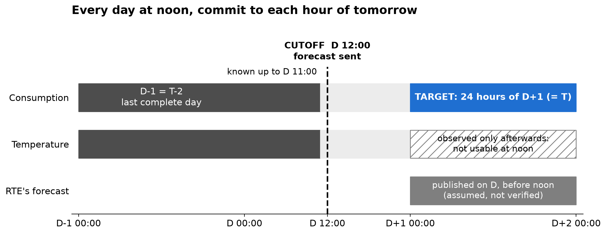
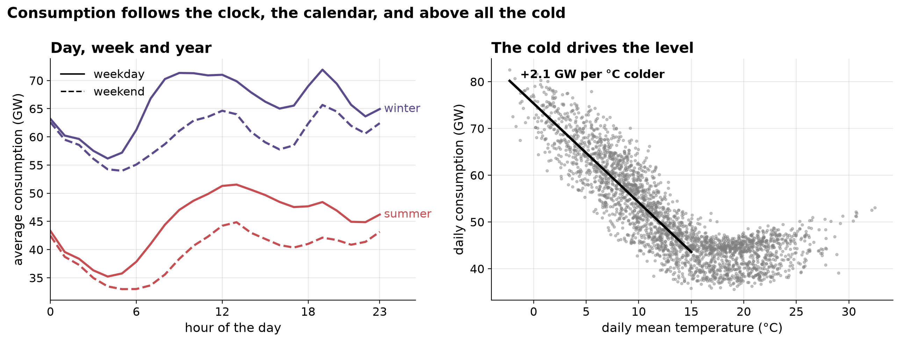
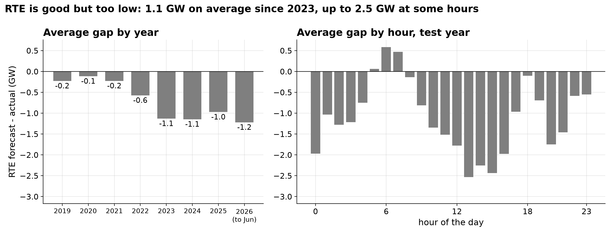
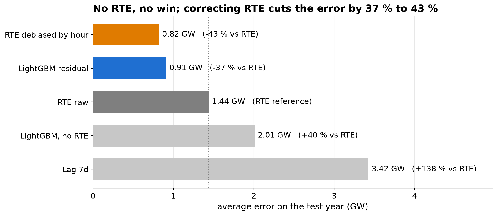
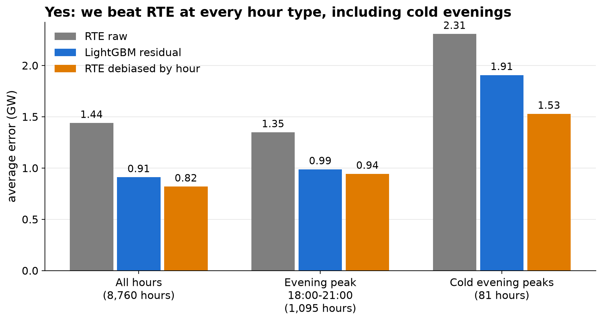
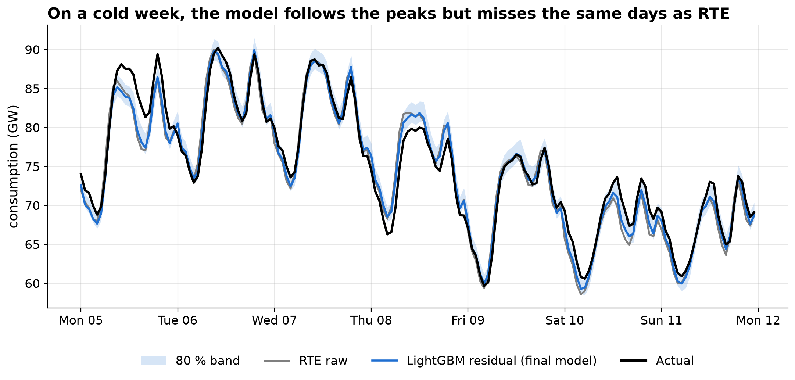
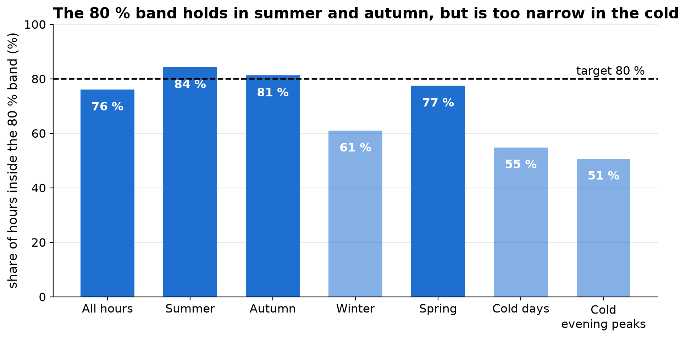
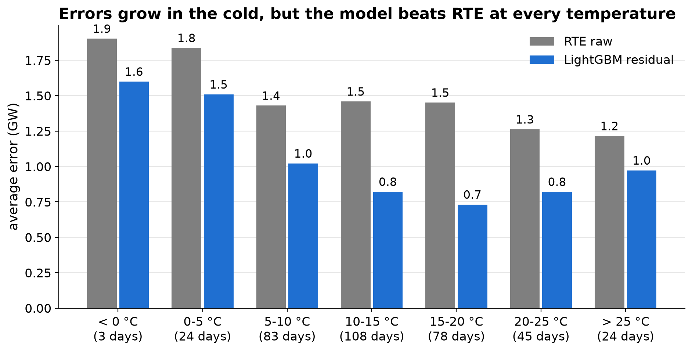
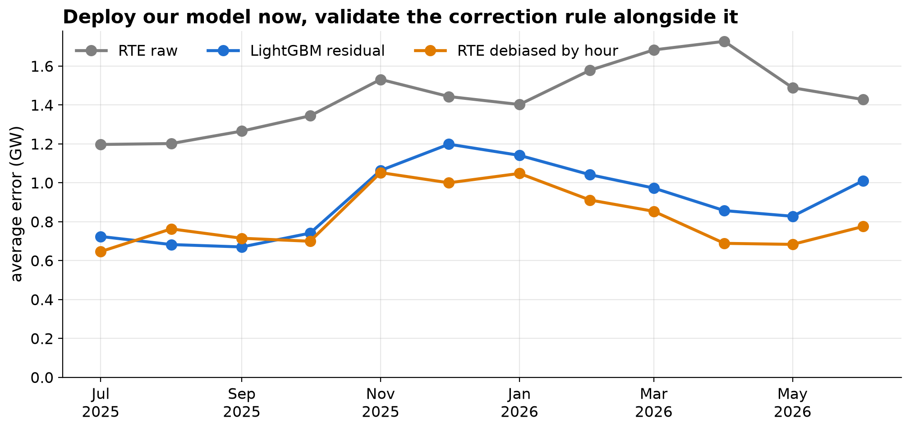

```{python}
import sys
sys.path.insert(0, "code")
from report_data import *

g_final, g_cand, g_norte = gain[FINAL], gain[CANDIDATE], gain["LightGBM, no RTE"]
m_rte, m_final, m_cand = (mae[n]["global"] for n in KPI)
cold_rte, cold_final, cold_cand = (mae[n]["evening_peak_cold_days"] for n in KPI)
w80, w95 = cov["All hours"]["width_80_(MW)"], cov["All hours"]["width_95_(MW)"]
c80, c95 = cov["All hours"]["coverage_80_%"], cov["All hours"]["coverage_95_%"]
cc80, cc95 = cov["Cold evening peaks"]["coverage_80_%"], cov["Cold evening peaks"]["coverage_95_%"]
```

::: {.callout-note appearance="simple"}
**In one sentence.** We don't beat RTE without its forecast, we beat it by correcting it: our final model cuts RTE's
error by `{python} pct(g_final)` on the test year, and a simple hourly debiasing rule by `{python} pct(g_cand)`.
:::

# Executive summary

Every day D before 12:00, a utility's trading desk buys on the day-ahead market the energy of each hour of D+1. It
needs a forecast of the 24 hours of tomorrow, made only with what is known at noon. RTE, the French grid operator,
publishes such a forecast for free: it is the benchmark to beat. The manager asked three questions.

| Question | Answer |
|---|---|
| **1. Can we do better than RTE, and by how much?** | Yes, by correcting RTE's forecast. Our final model (LightGBM on RTE's residual) has an MAE of `{python} mw(m_final)` against `{python} mw(m_rte)` for RTE (`{python} f"-{g_final:.1f} %"`). A simple rule, RTE minus its recent bias at the same hour, does even better: `{python} mw(m_cand)` (`{python} f"-{g_cand:.1f} %"`). |
| **2. How uncertain is it, and when does it fail?** | The 80 % and 95 % bands are about `{python} gw(w80, 1)` and `{python} gw(w95, 1)` wide. They hold `{python} pct(c80)` and `{python} pct(c95)` of test hours, but only `{python} pct(cc80)` and `{python} pct(cc95)` on cold evening peaks. The model fails when RTE fails: Christmas week, holidays, cold days, some weekends. |
| **3. What should we deploy, and what are the risks?** | The LightGBM residual now (chosen by a rule fixed before the test, with uncertainty bands), and the hourly debiasing rule alongside it as a candidate. Main risk: RTE's forecast must be published before noon, which is not verified yet. |

: The manager's three questions {tbl-colwidths="[30,70]"}

```{python}
#| output: asis
#| label: tbl-kpi
#| tbl-cap: "MAE on the test year (1 July 2025 to 30 June 2026). Cold evening peaks = 18:00-21:00 on days below 5 °C."
print(kpi_table())
```

# The problem and the rules of the game

{fig-alt="Timeline of what is known at the cutoff"}

- **Cutoff.** The forecast is sent on D at 12:00, Paris time. Consumption is known up to D 11:00, so for a target
  day T = D+1 the last complete day is T-2. Every feature has a lag of 48 hours or more.
- **Target.** The 24 hourly loads of D+1, i.e. 12 to 36 hours ahead.
- **Test year.** 1 July 2025 to 30 June 2026 (8,760 hours). It is only used to report. Every choice (training
  period, hyperparameters, final model) is made on 4 quarterly walk-forward folds, July 2024 to June 2025.
- **Metric.** MAE in MW on three scopes: all hours, the evening peak (18:00-21:00, the most expensive hours) and the
  evening peak of cold days (daily mean temperature below `{python} f"{COLD_DAY_C:.0f}"` °C, `{python} N_COLD_PEAK_HOURS`
  hours on `{python} N_COLD_DAYS` days).
- **Temperature.** The dataset holds the observed temperature, not a weather forecast. Using the temperature of
  D+1 would mean a perfect weather forecast, so we use the temperature of T-2 ("persistence") and only show the
  observed one as an upper bound.
- **Data.** Hourly national consumption from `{python} f"{df['date'].min():%d %B %Y}"` to
  `{python} f"{df['date'].max():%d %B %Y}"` (`{python} f"{df.height:,}"` hours), with temperature and RTE's
  day-ahead forecast. Only 7 RTE values are missing (one per year, at the autumn clock change).

# What we forecast

{fig-alt="Daily profiles and temperature sensitivity"}

Exploration (notebook `00_eda`) shows:

- **Three seasonalities.** Daily (low at night, peaks in the morning and at 19:00 in winter), weekly (weekends are
  much lower during the day) and yearly (winter days are almost twice summer days). STL gives a seasonal strength of
  0.81 for the week and 0.90 for the year.
- **The cold drives the level.** Below about 15 °C each degree less adds roughly 2 GW (heating); above, the load is
  flat with a small rise in heat waves. Temperature is the key variable, but D+1's temperature is unknown at the cutoff.
- **Usable lags.** Only 48 h and 168 h are available at the cutoff; both have an autocorrelation around 0.9.
- **Stationarity.** ADF and KPSS find no unit root on the daily series, but the 2022-2023 drop (energy crisis,
  sobriety) makes the choice of training years important.

# The benchmark: RTE is good but too low

{fig-alt="RTE's bias by year and by hour"}

RTE's forecast is accurate (MAPE `{python} f"{rte_test['MAPE']:.1f}"` % on the test year) but it has been too low by
about `{python} gw(-bias_2023, 1)` since 2023: it did not follow the lower post-crisis consumption. On the test year
its bias is `{python} mw(rte_test["bias"])` and it depends on the hour. A systematic error can be corrected: this
is the observation the whole project turns on.

# Our path: from naive baselines to correcting RTE

{fig-alt="Ladder of the models by test MAE"}

We followed the course milestones, each notebook with the same layout (verdict, setup, model, results, where it fails,
conclusion, appendix).

## Naive baselines (`01_baseline`)

Same hour one week before (lag 7d) and two days before (lag 2d). Both are more than twice RTE's error. Lag 7d breaks
on cold days and weather changes (9.2 GW of MAE on cold evening peaks, since it copies a milder week); lag 2d breaks
when the copied day is of another type (Sunday for Tuesday).

## Classical daily models (`02_ar`, `03_sarima`)

On the daily mean, trained on 2023 to mid-2025:

- **AR(8) on the anomaly.** Consumption = a seasonal normal (2 Fourier pairs + one level per weekday) + an anomaly,
  modelled as an AR(p). The PACF rule and the AIC both give p = 8.
- **SARIMA(2,0,2)(0,1,1)~7~** and **Holt-Winters** (additive weekly season, damped trend). Both boil down to a fixed
  weekly profile on a very persistent level.
- **SARIMAX** with heating and cooling degrees and holidays, as a regression with SARIMA errors: each heating degree
  adds 0.75 GW, a holiday removes 3.8 GW.

```{python}
#| output: asis
#| label: tbl-daily
#| tbl-cap: "Daily models, MAE of the daily mean in GW (not comparable with the hourly MW)."
print(md_table(daily_score.select(
    pl.col("forecast").str.replace_all("_", " ").alias("Forecast"),
    pl.col("MAE").alias("MAE (GW)"),
    pl.col("bias").alias("Bias (GW)"),
    pl.col("vs_reference_(%)").map_elements(lambda v: f"{v:+.1f} %", return_dtype=pl.String).alias("vs RTE raw"),
)))
```

None of them beats RTE. They react to cold spells about two days late, and even with a perfect weather forecast the
SARIMAX only matches RTE.

## Hourly LightGBM (`04_lightgbm`)

One gradient boosting model for the 24 hours of D+1, with lags of 48 h and more, rolling means, calendar, holidays
and the T-2 temperature. A perturbation test (add 10 GW at hour s, the first changed feature row must be s + 48)
checks the cutoff. Starting the training in 2019 beats 2023 on every fold, and hyperparameters matter much less.

- **Without RTE**, our best honest model reaches `{python} mw(mae["LightGBM, no RTE"]["global"])`,
  `{python} pct(-g_norte)` worse than RTE. Only the upper bound with observed temperature beats it.
- **With RTE's forecast as a feature**, LightGBM gets 908 MW. RTE's forecast takes 99 % of the gain: the model is
  really a per-hour correction of RTE. But trees cannot extrapolate, so peaks are cut (85 GW for an actual 90 GW).

## Final model: LightGBM on RTE's residual (`05_final_model`)

The target becomes load - RTE, and the forecast is RTE + learnt correction. The peaks come from RTE, no
extrapolation is needed. On the folds it ties with LightGBM + RTE (860 MW each, 0.09 % apart); the rule fixed
beforehand (best mean, then best on cold evening peaks if within 1 %) picks the residual model (1,478 vs 1,557 MW on
cold evening peaks). Prediction intervals are split conformal: per-hour quantiles of the validation errors.

## Extension: debiasing RTE's forecast (`extension_rte_debiased`)

No training at all: RTE minus its mean error at the same local hour over the 28 days T-29 to T-2. It is the best on
the folds (`{python} mw(FOLDS_MAE[CANDIDATE])` vs `{python} mw(FOLDS_MAE[FINAL])`) and on the test. A flat
correction (same for every hour) is not enough: RTE's bias depends on the hour.

```{python}
#| output: asis
#| label: tbl-hourly
#| tbl-cap: "All hourly forecasts on the test year, MAE in MW (table of 06_comparison)."
print(md_table(all_hourly.select(
    pl.col("forecast").str.replace_all("_", " ").str.replace("UPPER", "upper").alias("Forecast"),
    *[pl.col(c).map_elements(mw, return_dtype=pl.String).alias(label) for c, label in
      [("global", "All hours"), ("evening_peak_18-20h", "Evening peak"), ("evening_peak_cold_days", "Cold evening peaks")]],
    pl.col("vs_reference_(%)").map_elements(lambda v: f"{v:+.1f} %", return_dtype=pl.String).alias("vs RTE raw"),
)))
```

# Q1. Can we beat RTE? Yes, on every scope

{fig-alt="MAE by scope for RTE raw, the final model and the candidate"}

Both corrected forecasts beat RTE on all hours, on the evening peak and on the cold evening peaks that cost the
most: `{python} pct(cold_gain[FINAL])` lower error there for the final model, `{python} pct(cold_gain[CANDIDATE])`
for the debiasing rule. The same order holds on the walk-forward folds (`{python} mw(FOLDS_MAE[CANDIDATE])`,
`{python} mw(FOLDS_MAE[FINAL])` and `{python} mw(FOLDS_MAE["RTE raw"])`), so the result is not an artefact of the
test year.

::: {.callout-warning}
## Too good to be true?

Beating the benchmark by a third is a bug until proven otherwise. We checked: lags of 48 h or more everywhere
(perturbation test), chronological splits, nothing tuned on the test. The gain comes from a real, large and
hour-dependent bias of RTE. Two caveats remain: RTE's publication time is assumed, not verified, and we used
consolidated data rather than the real-time vintage available at noon.
:::

# Q2. How uncertain, and when does it fail?

## On a cold week, the model misses the same days as RTE

{fig-alt="Cold week of January 2026 with the 80 % band"}

The final model reaches the peaks (90.0 GW for an actual 90.2 GW) but misses whole days when RTE does. On the 15
worst days of the test year, the final model and RTE err in the same direction: Christmas week, holidays (1 November
on a Saturday), cold days (21 November, 5 January), some weekends and Mondays. The model removes RTE's usual error,
not its error of the day.

## The 80 % band holds on average, not in the cold

{fig-alt="Coverage of the 80 % band by scope"}

```{python}
#| output: asis
#| label: tbl-coverage
#| tbl-cap: "Coverage and width of the conformal intervals of the final model on the test year."
print(md_table(coverage.select(
    pl.col("scope").alias("Scope"),
    pl.col("hours").alias("Hours"),
    pl.col("coverage_80_%").map_elements(pct, return_dtype=pl.String).alias("Coverage 80 %"),
    pl.col("width_80_(MW)").map_elements(mw, return_dtype=pl.String).alias("Width 80 %"),
    pl.col("coverage_95_%").map_elements(pct, return_dtype=pl.String).alias("Coverage 95 %"),
    pl.col("width_95_(MW)").map_elements(mw, return_dtype=pl.String).alias("Width 95 %"),
)))
```

The width depends only on the hour, not on season or temperature, so the band is narrowest where errors cost the
most. Conditioning on "cold at the cutoff" (T-2 below 5 °C) only lifts the 80 % coverage on cold days from 55 % to
65 %. A safety margin, or regimes based on RTE's forecast level, would probably work better.

## Errors grow in the cold, but the model beats RTE at every temperature

{fig-alt="Daily MAE by temperature bin"}

The error roughly doubles below 5 °C compared with mild days, and these days are rare (`{python} N_COLD_DAYS` in the
test year, 3 below 0 °C). Cold evening peaks are 0.9 % of hours but 1.9 % of the final model's error volume, and
imbalance prices are highest there.

# Q3. What to deploy, and the risks

{fig-alt="Monthly MAE of RTE raw, the final model and the candidate"}

**Recommendation.** Deploy the LightGBM residual (`05`): it was chosen by a rule fixed before the test and it comes
with prediction intervals. Run the hourly debiasing rule alongside it as a candidate: it is simpler and better on
average (`{python} mw(m_cand)` vs `{python} mw(m_final)`), but it was added after the selection rule of `05` and has
no uncertainty band yet. Fallbacks: RTE raw if our model breaks, the LightGBM without RTE
(`{python} mw(mae["LightGBM, no RTE"]["global"])`) if RTE is late.

| Risk | Impact | Mitigation |
|---|---|---|
| RTE's forecast arrives after noon (assumed, not verified) | Both corrected forecasts need it | Check RTE's publication calendar; fall back to the LightGBM without RTE |
| RTE's bias changes suddenly | The rule takes about a month (28-day window) to follow; the LightGBM until retraining | Monitor the 7-day bias, alert beyond ±0.5 GW, retrain regularly |
| Live data differ from the consolidated data we tested on | Live error higher than measured | Replay the model on archived real-time data before go-live |
| Extreme cold and unusual holidays | Worst days; the 80 % band only holds `{python} pct(cc80)` of cold evening peaks | Manual override and a wider safety margin on cold days and around holidays |

: Deployment risks {tbl-colwidths="[28,32,40]"}

# Limits and next steps

- **Weather forecast.** With the observed temperature as an upper bound, LightGBM without RTE reaches 1,184 MW: a
  real weather forecast is the main lever to become independent from RTE.
- **Intervals in the cold.** Make the conformal bands depend on a regime known at the cutoff (RTE's forecast level,
  forecast temperature), or add a fixed margin on cold days.
- **Intervals for the debiasing rule.** The same split conformal method applies directly to its errors.
- **Real-time data.** Re-run the evaluation on the real-time vintage before trusting the measured gains.

# Appendix {.appendix}

## Definitions

- **MAE (mean absolute error)**: average of |forecast - actual| over the hours of a scope, in MW. Lower is better.
  "vs RTE raw" is the relative gap to RTE's MAE.
- **Bias**: average of (forecast - actual). Negative means the forecast is too low.
- **Walk-forward validation**: train on the past, test on the next quarter, 4 times (July 2024 to June 2025).
- **Coverage**: share of test hours where the actual load falls inside the prediction interval.

## Reproducibility

The numbers of this report are computed at render time from the test forecasts saved in `data/predictions/`
(`code/report_data.py`), and the figures come from `code/07_executive_summary.ipynb`. To rebuild it, run the notebooks
`01` to `05`, the extension and `07`, then from `reports/`:

```bash
quarto render            # output/report.html and output/one_pager.pdf
```

| Notebook | Content |
|---|---|
| `00_eda` | exploration of the series and of RTE's error |
| `01_baseline` | naive baselines vs RTE |
| `02_ar`, `03_sarima` | daily models: AR, SARIMA, Holt-Winters, SARIMAX |
| `04_lightgbm` | hourly LightGBM, walk-forward |
| `05_final_model` | final model, prediction intervals, failures, deployment risks |
| `06_comparison` | all models in one table |
| `extension_rte_debiased` | debiasing RTE's forecast, best result |
| `07_executive_summary` | storyline for management, figures of this report |
